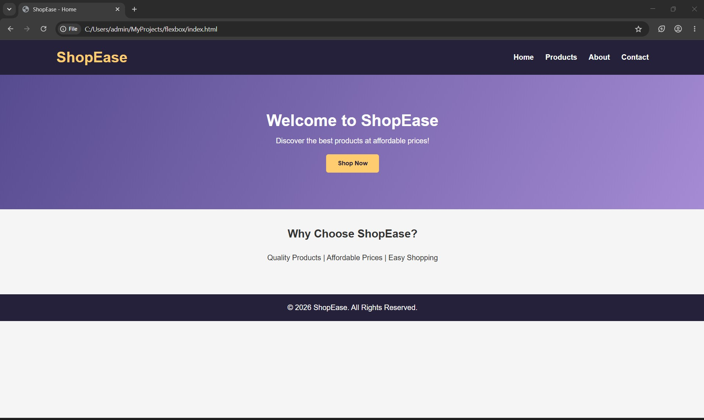
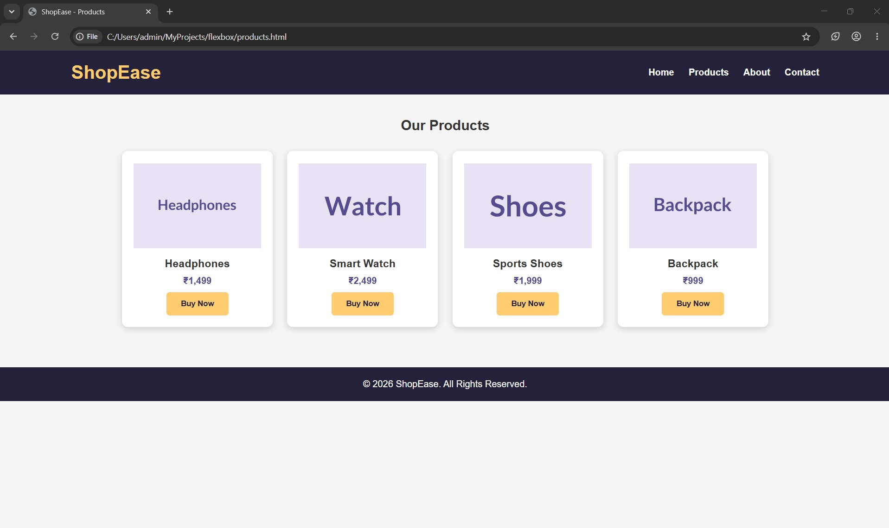
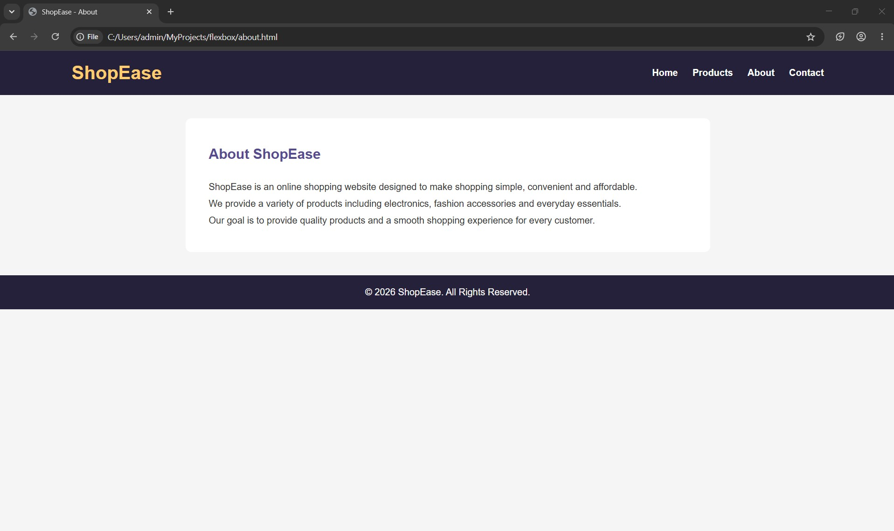
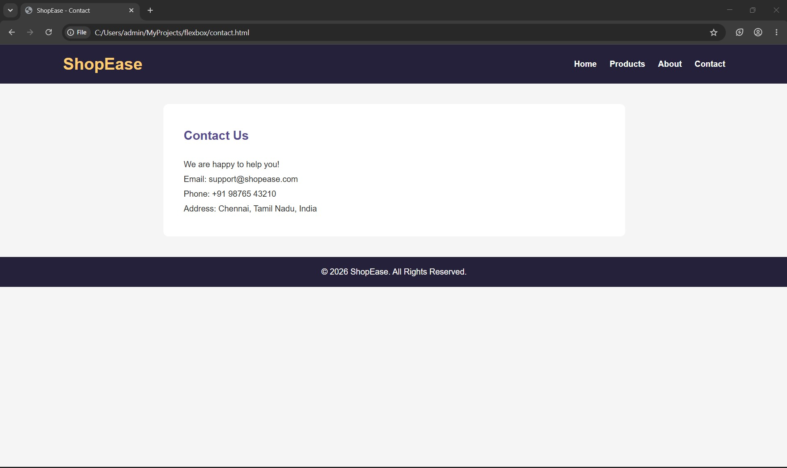

# Ex02 Commercial Website
## Date:30.10.2026

## AIM
To create a commercial website using CSS Flexbox.

## ALGORITHM
### STEP 1
Create an HTML file (index.html)

### STEP 2
Create a CSS file (style.css)

### STEP 3
Include a navigation bar with links to different sections.

### STEP 4
Add structured sections for Homepage, Products / Services, About Us, Contact Details and User Account.

### STEP 5
Include social media links at the footer with copyright information.

### STEP 6
Define global styles for fonts, colors, and layout.

### STEP 7
Style the header, navigation bar, and sections.

### STEP 8
Use Flexbox for layout design.

### STEP 9
Add hover effects and transitions for interactivity.

### STEP 10
Add Images and Media.

### STEP 11
Use optimized images for a professional look.

### STEP 12
Open the HTML file in a browser to check layout and functionality.

### STEP 13
Fix styling issues and refine content placement.

### STEP 14
Deploy the website.

### STEP 15
Upload to GitHub Pages for free hosting.

## PROGRAM
```

<!DOCTYPE html>
<html>
<head>
    <title>ShopEase - Home</title>
    <link rel="stylesheet" href="style.css">
    <meta name="viewport" content="width=device-width, initial-scale=1.0">
</head>
<body>

<header>
    <h1>ShopEase</h1>
    <nav>
        <a href="index.html">Home</a>
        <a href="products.html">Products</a>
        <a href="about.html">About</a>
        <a href="contact.html">Contact</a>
    </nav>
</header>

<section class="hero">
    <h2>Welcome to ShopEase</h2>
    <p>Discover the best products at affordable prices!</p>
    <a href="products.html">
        <button>Shop Now</button>
    </a>
</section>

<section class="products">
    <h2>Why Choose ShopEase?</h2>
    <p>Quality Products | Affordable Prices | Easy Shopping</p>
</section>

<footer>
    <p>&copy; 2026 ShopEase. All Rights Reserved.</p>
</footer>

</body>
</html>
```
```

<!DOCTYPE html>
<html>
<head>
    <title>ShopEase - Products</title>
    <link rel="stylesheet" href="style.css">
    <meta name="viewport" content="width=device-width, initial-scale=1.0">
</head>
<body>

<header>
    <h1>ShopEase</h1>
    <nav>
        <a href="index.html">Home</a>
        <a href="products.html">Products</a>
        <a href="about.html">About</a>
        <a href="contact.html">Contact</a>
    </nav>
</header>

<section class="products">
    <h2>Our Products</h2>

    <div class="product-container">

        <div class="product-card">
            
            <h3>Headphones</h3>
            <p>₹1,499</p>
            <button>Buy Now</button>
        </div>

        <div class="product-card">
            
            <h3>Smart Watch</h3>
            <p>₹2,499</p>
            <button>Buy Now</button>
        </div>

        <div class="product-card">
            
            <h3>Sports Shoes</h3>
            <p>₹1,999</p>
            <button>Buy Now</button>
        </div>

        <div class="product-card">
            
            <h3>Backpack</h3>
            <p>₹999</p>
            <button>Buy Now</button>
        </div>

    </div>
</section>

<footer>
    <p>&copy; 2026 ShopEase. All Rights Reserved.</p>
</footer>

</body>
</html>
```
```

<!DOCTYPE html>
<html>
<head>
    <title>ShopEase - About</title>
    <link rel="stylesheet" href="style.css">
    <meta name="viewport" content="width=device-width, initial-scale=1.0">
</head>
<body>

<header>
    <h1>ShopEase</h1>
    <nav>
        <a href="index.html">Home</a>
        <a href="products.html">Products</a>
        <a href="about.html">About</a>
        <a href="contact.html">Contact</a>
    </nav>
</header>

<section class="content">
    <h2>About ShopEase</h2>

    <p>
        ShopEase is an online shopping website designed to make
        shopping simple, convenient and affordable.
    </p>

    <p>
        We provide a variety of products including electronics,
        fashion accessories and everyday essentials.
    </p>

    <p>
        Our goal is to provide quality products and a smooth
        shopping experience for every customer.
    </p>
</section>

<footer>
    <p>&copy; 2026 ShopEase. All Rights Reserved.</p>
</footer>

</body>
</html>
```
```

<!DOCTYPE html>
<html>
<head>
    <title>ShopEase - Contact</title>
    <link rel="stylesheet" href="style.css">
    <meta name="viewport" content="width=device-width, initial-scale=1.0">
</head>
<body>

<header>
    <h1>ShopEase</h1>
    <nav>
        <a href="index.html">Home</a>
        <a href="products.html">Products</a>
        <a href="about.html">About</a>
        <a href="contact.html">Contact</a>
    </nav>
</header>

<section class="content">
    <h2>Contact Us</h2>

    <p>We are happy to help you!</p>

    <p>Email: support@shopease.com</p>

    <p>Phone: +91 98765 43210</p>

    <p>Address: Chennai, Tamil Nadu, India</p>
</section>

<footer>
    <p>&copy; 2026 ShopEase. All Rights Reserved.</p>
</footer>

</body>
</html>
```
```

* {
    margin: 0;
    padding: 0;
    box-sizing: border-box;
    font-family: Arial, sans-serif;
}

body {
    background: #f5f5f5;
    color: #333;
}

/* Header */
header {
    background: #25213b;
    color: white;
    padding: 20px 8%;
    display: flex;
    justify-content: space-between;
    align-items: center;
    flex-wrap: wrap;
    gap: 15px;
}

header h1 {
    color: #ffcc70;
}

nav {
    display: flex;
    gap: 25px;
    flex-wrap: wrap;
}

nav a {
    color: white;
    text-decoration: none;
    font-weight: bold;
}

nav a:hover {
    color: #ffcc70;
}

/* Main content */
.hero {
    background: linear-gradient(120deg, #574b90, #a58bd3);
    color: white;
    text-align: center;
    padding: 80px 20px;
}

.hero h2 {
    font-size: 35px;
    margin-bottom: 15px;
}

.hero p {
    margin-bottom: 20px;
}

button {
    background: #ffcc70;
    color: #25213b;
    border: none;
    padding: 12px 25px;
    border-radius: 5px;
    cursor: pointer;
    font-weight: bold;
}

/* Products */
.products {
    padding: 40px 8%;
    text-align: center;
}

.products h2 {
    margin-bottom: 30px;
}

.product-container {
    display: flex;
    justify-content: center;
    flex-wrap: wrap;
    gap: 25px;
}

.product-card {
    background: white;
    padding: 20px;
    width: 220px;
    flex: 1 1 200px;
    max-width: 260px;
    border-radius: 10px;
    box-shadow: 0 3px 10px #ccc;
    text-align: center;
}

.product-card img {
    width: 100%;
    height: 150px;
    object-fit: contain;
}

.product-card h3 {
    margin: 10px;
}

.product-card p {
    color: #574b90;
    margin: 10px;
    font-weight: bold;
}

/* Content pages */
.content {
    background: white;
    margin: 40px auto;
    padding: 40px;
    max-width: 900px;
    border-radius: 10px;
    line-height: 1.8;
}

.content h2 {
    color: #574b90;
    margin-bottom: 20px;
}

/* Footer */
footer {
    background: #25213b;
    color: white;
    text-align: center;
    padding: 20px;
    margin-top: 30px;
}

/* Responsive */
@media (max-width: 600px) {
    header {
        flex-direction: column;
        text-align: center;
    }

    nav {
        justify-content: center;
        gap: 15px;
    }

    .hero h2 {
        font-size: 26px;
    }

    .product-card {
        max-width: 100%;
        flex: 1 1 100%;
    }

    .content {
        margin: 20px 12px;
        padding: 20px;
    }
}
```
## OUTPUT





## RESULT
The program for creating commercial website using CSS Flexbox is executed successfully.
