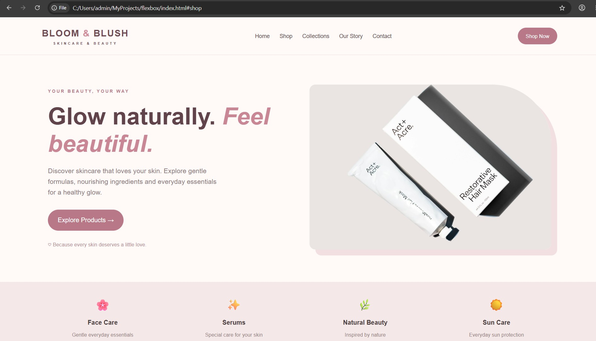
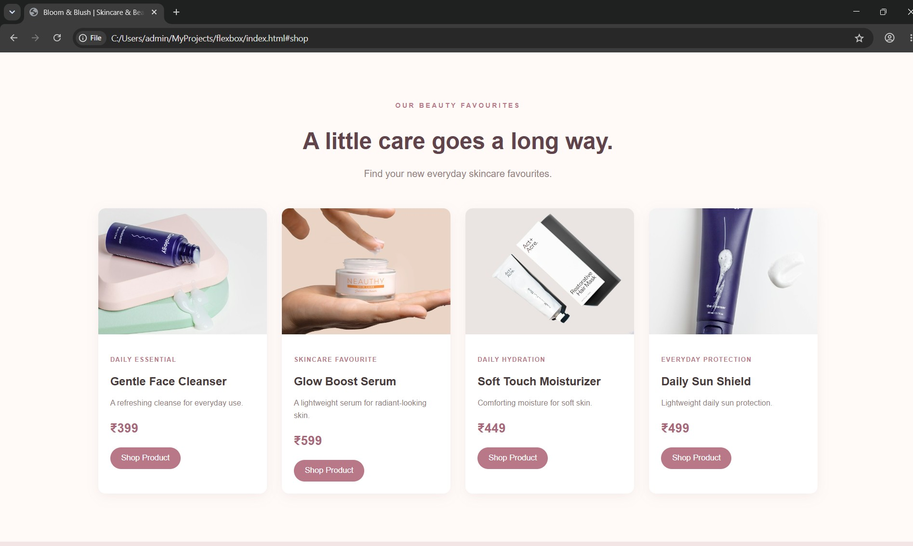
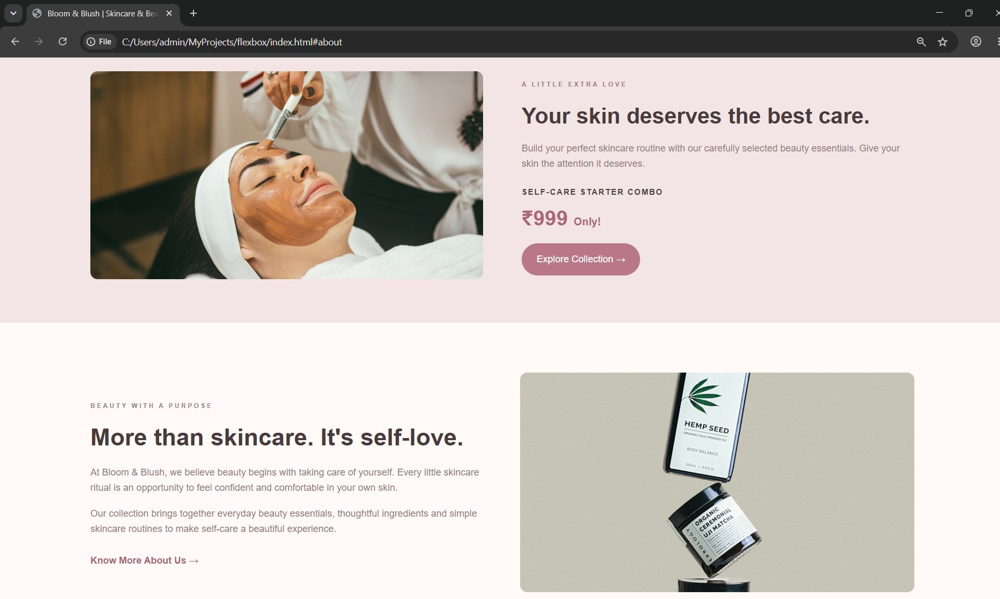
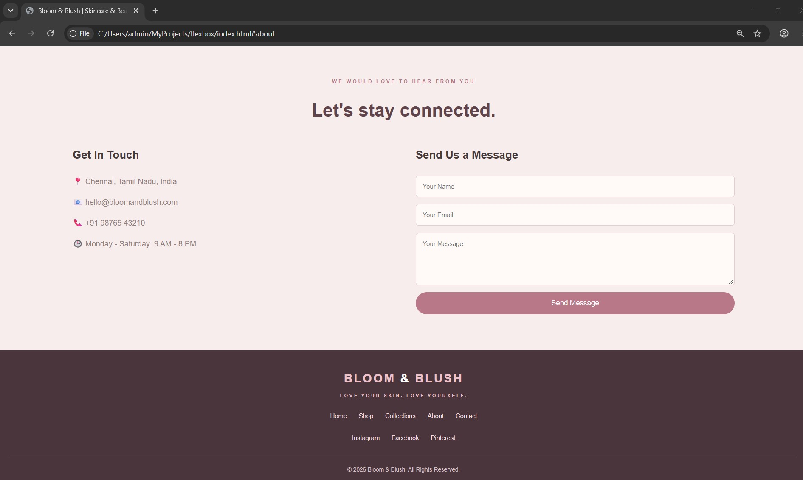

# Ex02 Commercial Website
## Date:30.10.2026

## AIM
To create a commercial website using CSS Flexbox.

## ALGORITHM
### STEP 1
Create an HTML file (index.html)

### STEP 2
Create a CSS file (style.css)

### STEP 3
Include a navigation bar with links to different sections.

### STEP 4
Add structured sections for Homepage, Products / Services, About Us, Contact Details and User Account.

### STEP 5
Include social media links at the footer with copyright information.

### STEP 6
Define global styles for fonts, colors, and layout.

### STEP 7
Style the header, navigation bar, and sections.

### STEP 8
Use Flexbox for layout design.

### STEP 9
Add hover effects and transitions for interactivity.

### STEP 10
Add Images and Media.

### STEP 11
Use optimized images for a professional look.

### STEP 12
Open the HTML file in a browser to check layout and functionality.

### STEP 13
Fix styling issues and refine content placement.

### STEP 14
Deploy the website.

### STEP 15
Upload to GitHub Pages for free hosting.

## PROGRAM

.html
```
<!DOCTYPE html>
<html lang="en">
<head>
    <meta charset="UTF-8">
    <meta name="viewport" content="width=device-width, initial-scale=1.0">
    <title>Bloom & Blush | Skincare & Beauty</title>
    <link rel="stylesheet" href="style.css">
</head>

<body>

    <!-- Header -->
    <header>
        <div class="logo">
            BLOOM <span>&</span> BLUSH
            <small>SKINCARE & BEAUTY</small>
        </div>

        <nav>
            <a href="#home">Home</a>
            <a href="#shop">Shop</a>
            <a href="#collections">Collections</a>
            <a href="#about">Our Story</a>
            <a href="#contact">Contact</a>
        </nav>

        <a href="#shop" class="nav-button">Shop Now</a>
    </header>

    <!-- Hero Section -->
    <section class="hero" id="home">

        <div class="hero-content">
            <p class="eyebrow">YOUR BEAUTY, YOUR WAY</p>

            <h1>Glow naturally. <span>Feel beautiful.</span></h1>

            <p class="hero-text">
                Discover skincare that loves your skin.
                Explore gentle formulas, nourishing ingredients
                and everyday essentials for a healthy glow.
            </p>

            <a href="#shop" class="main-button">Explore Products →</a>

            <p class="hero-note">
                ♡ Because every skin deserves a little love.
            </p>
        </div>

        <div class="hero-image">
            
        </div>

    </section>

    <!-- Categories -->
    <section class="categories" id="collections">

        <div class="category">
            <span>🌸</span>
            <h3>Face Care</h3>
            <p>Gentle everyday essentials</p>
        </div>

        <div class="category">
            <span>✨</span>
            <h3>Serums</h3>
            <p>Special care for your skin</p>
        </div>

        <div class="category">
            <span>🌿</span>
            <h3>Natural Beauty</h3>
            <p>Inspired by nature</p>
        </div>

        <div class="category">
            <span>☀️</span>
            <h3>Sun Care</h3>
            <p>Everyday sun protection</p>
        </div>

    </section>

    <!-- Products Section -->
    <section class="shop" id="shop">

        <div class="section-heading">
            <p class="eyebrow">OUR BEAUTY FAVOURITES</p>
            <h2>A little care goes a long way.</h2>
            <p>Find your new everyday skincare favourites.</p>
        </div>

        <div class="product-container">

            <div class="product-card">
                

                <div class="card-info">
                    <span>DAILY ESSENTIAL</span>
                    <h3>Gentle Face Cleanser</h3>
                    <p>A refreshing cleanse for everyday use.</p>
                    <div class="price">₹399</div>
                    <button>Shop Product</button>
                </div>
            </div>

            <div class="product-card">
                

                <div class="card-info">
                    <span>SKINCARE FAVOURITE</span>
                    <h3>Glow Boost Serum</h3>
                    <p>A lightweight serum for radiant-looking skin.</p>
                    <div class="price">₹599</div>
                    <button>Shop Product</button>
                </div>
            </div>

            <div class="product-card">
                

                <div class="card-info">
                    <span>DAILY HYDRATION</span>
                    <h3>Soft Touch Moisturizer</h3>
                    <p>Comforting moisture for soft skin.</p>
                    <div class="price">₹449</div>
                    <button>Shop Product</button>
                </div>
            </div>

            <div class="product-card">
                

                <div class="card-info">
                    <span>EVERYDAY PROTECTION</span>
                    <h3>Daily Sun Shield</h3>
                    <p>Lightweight daily sun protection.</p>
                    <div class="price">₹499</div>
                    <button>Shop Product</button>
                </div>
            </div>

        </div>

    </section>

    <!-- Special Offer -->
    <section class="special">

        <div class="special-image">
            
        </div>

        <div class="special-content">
            <p class="eyebrow">A LITTLE EXTRA LOVE</p>

            <h2>Your skin deserves the best care.</h2>

            <p>
                Build your perfect skincare routine with
                our carefully selected beauty essentials.
                Give your skin the attention it deserves.
            </p>

            <h3>SELF-CARE STARTER COMBO</h3>

            <h2 class="offer-price">₹999 <span>Only!</span></h2>

            <a href="#shop" class="main-button">Explore Collection →</a>
        </div>

    </section>

    <!-- About Section -->
    <section class="about" id="about">

        <div class="about-content">
            <p class="eyebrow">BEAUTY WITH A PURPOSE</p>

            <h2>More than skincare. It's self-love.</h2>

            <p>
                At Bloom & Blush, we believe beauty begins
                with taking care of yourself. Every little
                skincare ritual is an opportunity to feel
                confident and comfortable in your own skin.
            </p>

            <p>
                Our collection brings together everyday
                beauty essentials, thoughtful ingredients
                and simple skincare routines to make
                self-care a beautiful experience.
            </p>

            <a href="#contact" class="text-link">Know More About Us →</a>
        </div>

        <div class="about-image">
            
        </div>

    </section>

    <!-- Customer Reviews -->
    <section class="reviews">

        <div class="section-heading">
            <p class="eyebrow">LOVE FROM OUR CUSTOMERS</p>
            <h2>Little words, big smiles.</h2>
        </div>

        <div class="review-container">

            <div class="review-card">
                <h3>★★★★★</h3>
                <p>
                    "Beautiful products and lovely packaging.
                    Shopping here was a wonderful experience!"
                </p>
                <h4>— Ananya</h4>
            </div>

            <div class="review-card">
                <h3>★★★★★</h3>
                <p>
                    "I love the simple skincare collection.
                    Everything looks so elegant and beautiful."
                </p>
                <h4>— Priya</h4>
            </div>

            <div class="review-card">
                <h3>★★★★★</h3>
                <p>
                    "A lovely place to discover skincare
                    essentials. Great shopping experience!"
                </p>
                <h4>— Meera</h4>
            </div>

        </div>

    </section>

    <!-- Quote -->
    <section class="quote">
        <p>"Take time to bloom. You deserve every bit of it."</p>
        <span>— BLOOM & BLUSH</span>
    </section>

    <!-- Contact Section -->
    <section class="contact" id="contact">

        <div class="section-heading">
            <p class="eyebrow">WE WOULD LOVE TO HEAR FROM YOU</p>
            <h2>Let's stay connected.</h2>
        </div>

        <div class="contact-container">

            <div class="contact-info">
                <h3>Get In Touch</h3>

                <p>📍 Chennai, Tamil Nadu, India</p>
                <p>📧 hello@bloomandblush.com</p>
                <p>📞 +91 98877 32823</p>
                <p>🕒 Monday - Saturday: 9 AM - 8 PM</p>
            </div>

            <div class="contact-form">
                <h3>Send Us a Message</h3>

                <form onsubmit="event.preventDefault(); alert('Thank you for contacting Bloom & Blush!');">
                    <input type="text" placeholder="Your Name" required>
                    <input type="email" placeholder="Your Email" required>
                    <textarea placeholder="Your Message" required></textarea>
                    <button type="submit">Send Message</button>
                </form>
            </div>

        </div>

    </section>

    <!-- Footer -->
    <footer>

        <div class="footer-logo">
            BLOOM <span>&</span> BLUSH
            <p>LOVE YOUR SKIN. LOVE YOURSELF.</p>
        </div>

        <div class="footer-links">
            <a href="#home">Home</a>
            <a href="#shop">Shop</a>
            <a href="#collections">Collections</a>
            <a href="#about">About</a>
            <a href="#contact">Contact</a>
        </div>

        <div class="social-links">
            <a href="https://www.instagram.com/">Instagram</a>
            <a href="https://www.facebook.com/">Facebook</a>
            <a href="https://www.pinterest.com/">Pinterest</a>
        </div>

        <p class="copyright">
            © 2026 Bloom & Blush. All Rights Reserved.
        </p>

    </footer>

</body>
</html>

```
.css
```
* {
    margin: 0;
    padding: 0;
    box-sizing: border-box;
}

html {
    scroll-behavior: smooth;
}

body {
    font-family: Arial, sans-serif;
    background-color: #fffaf8;
    color: #493b3c;
    line-height: 1.6;
}

/* HEADER */
header {
    background-color: #fffaf8;
    padding: 22px 7%;
    display: flex;
    justify-content: space-between;
    align-items: center;
    flex-wrap: wrap;
    gap: 15px;
    border-bottom: 1px solid #f0dfdf;
}

.logo {
    font-size: 23px;
    font-weight: bold;
    letter-spacing: 2px;
    color: #714c54;
}

.logo span {
    color: #d18d9b;
}

.logo small {
    display: block;
    font-size: 9px;
    text-align: center;
    letter-spacing: 4px;
}

nav {
    display: flex;
    gap: 25px;
    flex-wrap: wrap;
}

nav a {
    text-decoration: none;
    color: #654f52;
    font-size: 14px;
    transition: 0.3s;
}

nav a:hover {
    color: #d18d9b;
}

.nav-button {
    background-color: #b97888;
    color: white;
    padding: 11px 20px;
    text-decoration: none;
    border-radius: 30px;
    font-size: 13px;
    transition: 0.3s;
}

.nav-button:hover {
    background-color: #875866;
}

/* HERO SECTION */
.hero {
    padding: 75px 8%;
    display: flex;
    justify-content: space-between;
    align-items: center;
    gap: 50px;
    min-height: 570px;
}

.hero-content {
    flex: 1;
}

.eyebrow {
    color: #b97888;
    font-size: 11px;
    font-weight: bold;
    letter-spacing: 3px;
    margin-bottom: 20px;
}

.hero h1 {
    font-size: 60px;
    line-height: 1.15;
    color: #61444b;
    margin-bottom: 22px;
}

.hero h1 span {
    color: #c98796;
    font-style: italic;
}

.hero-text {
    color: #8b7779;
    font-size: 17px;
    max-width: 430px;
    margin-bottom: 30px;
}

.main-button {
    display: inline-block;
    background-color: #b97888;
    color: white;
    padding: 14px 25px;
    border-radius: 30px;
    text-decoration: none;
    transition: 0.3s;
}

.main-button:hover {
    background-color: #875866;
    transform: translateY(-3px);
}

.hero-note {
    margin-top: 25px;
    color: #b28c91;
    font-size: 13px;
}

.hero-image {
    flex: 1;
}

.hero-image img {
    width: 100%;
    height: 420px;
    object-fit: cover;
    border-radius: 15px 150px 15px 15px;
    box-shadow: 15px 15px 0 #f1dfe2;
}

/* CATEGORIES */
.categories {
    background-color: #f4e8e9;
    padding: 35px 7%;
    display: flex;
    justify-content: space-around;
    align-items: center;
    gap: 25px;
    flex-wrap: wrap;
    text-align: center;
}

.category {
    flex: 1;
    min-width: 150px;
}

.category span {
    font-size: 30px;
}

.category h3 {
    font-size: 16px;
    margin: 8px 0;
}

.category p {
    color: #927c80;
    font-size: 13px;
}

/* SHOP SECTION */
.shop {
    padding: 80px 7%;
}

.section-heading {
    text-align: center;
    margin-bottom: 45px;
}

.section-heading h2 {
    font-size: 38px;
    color: #61444b;
    margin-bottom: 10px;
}

.section-heading > p:last-child {
    color: #927c80;
}

/* FLEXBOX PRODUCT CARDS */
.product-container {
    display: flex;
    justify-content: center;
    align-items: stretch;
    gap: 25px;
    flex-wrap: wrap;
}

.product-card {
    background-color: white;
    width: 250px;
    flex: 1 1 220px;
    max-width: 280px;
    border-radius: 12px;
    overflow: hidden;
    box-shadow: 0 5px 20px rgba(100, 60, 70, 0.08);
    transition: transform 0.3s, box-shadow 0.3s;
}

.product-card:hover {
    transform: translateY(-10px);
    box-shadow: 0 12px 25px rgba(100, 60, 70, 0.15);
}

.product-card img {
    width: 100%;
    height: 210px;
    object-fit: cover;
}

.card-info {
    padding: 20px;
}

.card-info span {
    font-size: 10px;
    color: #b97888;
    letter-spacing: 1.5px;
    font-weight: bold;
}

.card-info h3 {
    margin: 10px 0;
    font-size: 19px;
}

.card-info p {
    color: #927c80;
    font-size: 13px;
}

.price {
    color: #a9687a;
    font-size: 21px;
    font-weight: bold;
    margin: 15px 0;
}

.product-card button {
    background-color: #b97888;
    color: white;
    border: none;
    padding: 10px 18px;
    border-radius: 25px;
    cursor: pointer;
    transition: 0.3s;
}

.product-card button:hover {
    background-color: #875866;
}

/* SPECIAL OFFER */
.special {
    background-color: #f3e5e6;
    padding: 65px 9%;
    display: flex;
    justify-content: center;
    align-items: center;
    gap: 65px;
    flex-wrap: wrap;
}

.special-image {
    flex: 1;
    min-width: 260px;
}

.special-image img {
    width: 100%;
    height: 350px;
    object-fit: cover;
    border-radius: 12px;
}

.special-content {
    flex: 1;
    min-width: 260px;
}

.special-content h2 {
    font-size: 37px;
    line-height: 1.3;
    margin-bottom: 18px;
}

.special-content p {
    color: #927c80;
    margin-bottom: 20px;
}

.special-content h3 {
    font-size: 13px;
    letter-spacing: 2px;
    margin-top: 25px;
}

.special-content .offer-price {
    color: #a9687a;
    font-size: 35px;
    margin: 10px 0 20px;
}

.offer-price span {
    font-size: 18px;
}

/* ABOUT SECTION */
.about {
    padding: 85px 9%;
    display: flex;
    align-items: center;
    justify-content: space-between;
    gap: 60px;
    flex-wrap: wrap;
}

.about-content {
    flex: 1;
    min-width: 260px;
}

.about-content h2 {
    font-size: 40px;
    line-height: 1.3;
    margin-bottom: 20px;
}

.about-content p {
    color: #927c80;
    margin-bottom: 18px;
}

.text-link {
    display: inline-block;
    color: #a9687a;
    text-decoration: none;
    font-weight: bold;
    margin-top: 10px;
}

.text-link:hover {
    color: #61444b;
}

.about-image {
    flex: 1;
    min-width: 260px;
}

.about-image img {
    width: 100%;
    height: 370px;
    object-fit: cover;
    border-radius: 12px;
}

/* CUSTOMER REVIEWS */
.reviews {
    background-color: #fff4f3;
    padding: 75px 8%;
}

.review-container {
    display: flex;
    justify-content: center;
    align-items: stretch;
    gap: 25px;
    flex-wrap: wrap;
}

.review-card {
    background-color: white;
    flex: 1 1 220px;
    padding: 28px;
    border-radius: 12px;
    text-align: center;
    box-shadow: 0 5px 15px rgba(100, 60, 70, 0.06);
}

.review-card h3 {
    color: #d49aa5;
    margin-bottom: 15px;
    letter-spacing: 3px;
}

.review-card p {
    color: #927c80;
    font-size: 14px;
    margin-bottom: 15px;
}

.review-card h4 {
    color: #714c54;
}

/* QUOTE SECTION */
.quote {
    background-color: #79545e;
    color: #fff4f3;
    padding: 65px 20px;
    text-align: center;
}

.quote p {
    font-size: 28px;
    font-style: italic;
    margin-bottom: 15px;
}

.quote span {
    font-size: 11px;
    letter-spacing: 3px;
    color: #efcbd0;
}

/* CONTACT SECTION */
.contact {
    padding: 75px 9%;
    background-color: #f7eded;
}

.contact-container {
    display: flex;
    justify-content: space-between;
    gap: 50px;
    flex-wrap: wrap;
}

.contact-info,
.contact-form {
    flex: 1;
    min-width: 260px;
}

.contact-info h3,
.contact-form h3 {
    font-size: 23px;
    margin-bottom: 25px;
}

.contact-info p {
    margin: 18px 0;
    color: #927c80;
}

.contact-form form {
    display: flex;
    flex-direction: column;
    gap: 15px;
}

.contact-form input,
.contact-form textarea {
    width: 100%;
    padding: 14px;
    border: 1px solid #e4cdd1;
    border-radius: 6px;
    background-color: #fffaf8;
    font-family: Arial, sans-serif;
    outline: none;
}

.contact-form input:focus,
.contact-form textarea:focus {
    border-color: #b97888;
}

.contact-form textarea {
    height: 110px;
    resize: vertical;
}

.contact-form button {
    background-color: #b97888;
    color: white;
    padding: 14px;
    border: none;
    border-radius: 30px;
    cursor: pointer;
    font-size: 15px;
    transition: 0.3s;
}

.contact-form button:hover {
    background-color: #875866;
}

/* FOOTER */
footer {
    background-color: #49353b;
    color: #fff4f3;
    text-align: center;
    padding: 40px 20px 20px;
}

.footer-logo {
    font-size: 25px;
    font-weight: bold;
    letter-spacing: 3px;
    color: #edc2ca;
}

.footer-logo span {
    color: white;
}

.footer-logo p {
    font-size: 10px;
    letter-spacing: 3px;
    margin-top: 8px;
}

.footer-links,
.social-links {
    display: flex;
    justify-content: center;
    gap: 25px;
    flex-wrap: wrap;
    margin: 25px 0;
}

.footer-links a,
.social-links a {
    text-decoration: none;
    color: #f1dce0;
    font-size: 13px;
    transition: 0.3s;
}

.footer-links a:hover,
.social-links a:hover {
    color: #e6a8b5;
}

.copyright {
    border-top: 1px solid #775d64;
    padding-top: 20px;
    margin-top: 25px;
    color: #d2bfc2;
    font-size: 12px;
}

/* RESPONSIVE DESIGN */
@media (max-width: 768px) {

    header {
        flex-direction: column;
        gap: 20px;
    }

    nav {
        justify-content: center;
        gap: 15px;
    }

    .hero {
        flex-direction: column;
        text-align: center;
        padding: 50px 7%;
    }

    .hero h1 {
        font-size: 43px;
    }

    .hero-text {
        margin-left: auto;
        margin-right: auto;
    }

    .hero-image img {
        height: 300px;
    }

    .section-heading h2 {
        font-size: 30px;
    }

    .product-container {
        flex-direction: column;
        align-items: center;
    }

    .product-card {
        width: 100%;
        max-width: 350px;
    }

    .special,
    .about {
        flex-direction: column;
    }

    .special-content h2,
    .about-content h2 {
        font-size: 31px;
    }

    .quote p {
        font-size: 22px;
    }
}

```

## OUTPUT






## RESULT
The program for creating commercial website using CSS Flexbox is executed successfully.
